<div align="center">

# 🪐 MARSWALK

### Extravehicular Activity (EVA) Planning & Telemetry HUD for Mars

*Google Maps for the first Marswalk, but it knows slope, radiation, dust, and your oxygen.*

[](https://www.spaceappschallenge.org/)
[](https://react.dev/)
[](https://www.typescriptlang.org/)
[](#-offline--pwa)
[](#-license)

[**Live Demo**](https://marswalk-sooty.vercel.app) · [**Demo Video**](https://YOUR-VIDEO-LINK) · [**Methodology**](./METHODOLOGY.md) · [**More about the project**](https://drive.google.com/drive/folders/1kwQVVhulbeP265PZrkUgqo8EzQHZPnra?usp=sharing)



</div>

---

## Table of Contents

- [Overview](#-overview)
- [Hero Mission](#-hero-mission)
- [Features](#-features)
- [Data & Provenance](#-data--provenance)
- [Architecture](#-architecture)
- [Getting Started](#-getting-started)
- [Route Engine](#-route-engine)
- [Offline & PWA](#-offline--pwa)
- [Assumptions & Limitations](#-assumptions--limitations)
- [Project Structure](#-project-structure)
- [Roadmap](#-roadmap)
- [Credits](#-credits)
- [License](#-license)

---

## 🔭 Overview

NASA has mapped Mars for decades, but existing tools such as Mars Trek and the USGS-NASA geologic maps are built for regional and global views. Astronauts on a surface excursion need something different: a **hyperlocal, layered, safety-first view** of the exact ground they will walk.

**MARSWALK** is a tablet/HUD-style mission tool that fuses multiple NASA science datasets into a single interface for planning and executing a Mars surface EVA. It calculates slope-safe routes between science stops, tracks life-support budgets across the whole traverse, and surfaces the environmental hazards that matter most: slope, radiation, dust, and temperature.

Built for the **2026 NASA Space Apps Challenge**, *Mars surface exploration map* category.

---

## 🚀 Hero Mission

| | |
|---|---|
| **Site** | Gale Crater / lower Mount Sharp (Aeolis Mons), boxwork region |
| **Area** | ~5 × 5 km, centred near 4.725° S, 137.385° E |
| **Mission** | Sol 1, EVA 1: a 4-stop loop from the habitat airlock to study mineralized boxwork ridges and hollows, with a rendezvous at a pressurized rover, then return to base |
| **Crew** | Two fictional astronauts (CDR Sarah Thorne, PLT Leo Chen) used for the mission narrative |

Gale was chosen because Curiosity has studied the boxwork region in depth, giving us rich imagery and in-situ data to ground the plan in.

---

## ✨ Features

### 🥾 Slope-Aware Route Engine
- A\* pathfinding on a 256 × 256 cost grid (≈19.5 m per cell) running in a **Web Worker**, so the UI never blocks
- Hard **20° slope limit** for suited mobility (configurable, see [Assumptions](#-assumptions--limitations))
- **Safest vs Fastest** modes that re-weight the cost function
- Drag any waypoint and the route recalculates live

### 🗺️ Eight Blendable Data Layers
Independent opacity sliders and blend modes, with animated cross-fades:

| # | Layer | What it shows |
|---|---|---|
| 1 | Optical | CTX / HiRISE imagery base map |
| 2 | Topography | DEM hillshade / shaded relief |
| 3 | Slope | 0–8° safe · 8–15° caution · 15–20° steep · >20° blocked |
| 4 | Thermal | THEMIS thermal inertia (bedrock vs dust) |
| 5 | Mineralogy | CRISM-derived sulfates, clays, hematite zones |
| 6 | Geology | USGS geologic units for lower Mount Sharp |
| 7 | Hazards | Cliffs, scarps and high-roughness exclusion mask |
| 8 | Environment | MSL RAD and REMS reference values |

### 🏔️ 2D + 3D Dual Engine
- **2D tactical map** with MapLibre GL JS and vector route overlays
- **3D terrain flyover** with React Three Fiber, a displaced DEM mesh, a draped route, and cinematic orbit controls

### ⏱️ EVA Timeline & Life-Support Telemetry
Play the full 3+ hour traverse at 1×, 5× or 20× speed while the HUD tracks:
- Oxygen reserves (primary and secondary buffers)
- Suit battery state of charge
- Core suit temperature
- Cumulative radiation dose
- Threshold-based hazard alerts

### 🚨 Abort to Hab
One tap plots the shortest slope-safe return path from the astronaut's **current timeline position** back to the airlock.

### 🧤 Suit-Ready Ergonomics
- **Glove Mode:** oversized touch targets (52 px+), high contrast, simplified layout
- **Voice readout:** waypoint and hazard announcements via the Web Speech API
- **Surface POV cards:** real Curiosity Mastcam photos and science objectives for each stop
- **Printable EVA manifest:** one-click PDF with waypoints, distances, dwell times and contingencies

### 🔍 Data Honesty
Every layer carries a **REAL / DERIVED / SIMULATED** badge, and a provenance modal lists each source. Nothing is faked silently.

---

## 🧪 Data & Provenance

| Layer / Instrument | Mission & Source | Resolution | Status |
|---|---|---|---|
| CTX Optical | MRO Context Camera mosaic of Gale | ~6 m/px | 🟢 REAL |
| Topography | MOLA (Mars Global Surveyor) with Gale DTM | see METHODOLOGY | 🟢 REAL |
| THEMIS Night IR | 2001 Mars Odyssey, controlled mosaic | 100 m/px | 🟢 REAL |
| Mastcam imagery | MSL Curiosity, NASA PDS raw images | 1152–1648 px | 🟢 REAL |
| Slope | Sobel gradient computed from the DEM | 19.53 m/cell | 🔵 DERIVED |
| Roughness & hazards | Computed from DEM and geologic units | 19.53 m/cell | 🔵 DERIVED |
| CRISM mineralogy | MRO CRISM-based mineral indicators | ~18 m/cell | 🔵 DERIVED |
| Geologic units | USGS-NASA Planetary Geologic Mapping | vector | 🟢 REAL |
| Radiation & weather | Published MSL RAD / REMS reference values | n/a | 🟡 REFERENCE VALUES |
| Crew physiology, O₂ and power budgets | Engineering model (see METHODOLOGY) | n/a | 🟠 MODELLED |

> Any layer that cannot be sourced from official data is shown with a visible **SIMULATED** badge in the app.

---

## 🏗️ Architecture

```
┌─────────────────────────────────────────────────────────────┐
│                       MARSWALK HUD                          │
│   React 18 · Vite · TypeScript · Tailwind · Framer Motion   │
├──────────────────────────────┬──────────────────────────────┤
│        2D CARTOGRAPHY        │          3D FLYOVER          │
│         MapLibre GL          │   Three.js · React Three     │
│                              │            Fiber             │
├──────────────────────────────┴──────────────────────────────┤
│                      STATE (Zustand)                        │
│        Mission · Route · Layers · Timeline · HUD            │
├─────────────────────────────────────────────────────────────┤
│                  BACKGROUND WEB WORKER                      │
│          A* slope-aware solver · life-support model         │
├─────────────────────────────────────────────────────────────┤
│                 STATIC OFFLINE DATA BUNDLE                  │
│     /public/data: DEM · slope · hillshade · thermal · …     │
└─────────────────────────────────────────────────────────────┘
        ▲
        │  built offline by
   Python pipeline (/scripts): rasterio · numpy · scipy · Pillow
```

**Design principle:** all heavy data processing happens offline in Python. The app only loads small, pre-built files, so it is fast, deterministic and demo-proof.

---

## ⚡ Getting Started

### Prerequisites
- Node.js 18+ (20+ recommended)
- Python 3.9+ *(only needed to regenerate datasets)*

### Run locally
```bash
git clone https://github.com/YOUR-USERNAME/marswalk.git
cd marswalk
npm install

npm test          # unit tests (A* solver, slope calc)
npm run dev       # http://localhost:5173
```

### Production build & offline preview
```bash
npm run build
npm run preview
```

### Test on your phone
```bash
npm run dev -- --host
```
Then open the printed network URL on a device on the same Wi-Fi.

### Regenerate the data bundle
```bash
cd scripts
pip install -r requirements.txt
python generate_terrain_data.py
```

---

## 🧭 Route Engine

For each grid cell the solver uses:

```
cost = 1 + slope_penalty + roughness_penalty + radiation_penalty + hazard_penalty
```

- Cells above the **slope limit** (default 20°) or inside the **hazard mask** are impassable
- **Fastest** mode weights distance and time; **Safest** mode weights slope, roughness and dose more heavily
- Legs are chained as `Hab → S1 → S2 → S3 → S4 → Hab` and reported with distance, max slope, time, O₂ use and dose

Full details are in [METHODOLOGY.md](./METHODOLOGY.md).

---

## 📴 Offline & PWA

MARSWALK is installable and works with no network. A service worker caches the full data bundle, which matters for a tool meant to be used far from home.

---

## ⚠️ Assumptions & Limitations

We state these openly because planning tools are only as trustworthy as their assumptions.

- **Slope limit (20°)** is an engineering assumption for suited mobility, not a NASA-certified value
- **Life-support models** (oxygen, power, thermal) are simplified estimates for demonstration
- **Radiation and weather** use published reference values, not live Mars data
- **Resolution:** route accuracy is bounded by the DEM cell size (~19.5 m); real EVA planning would use sub-metre HiRISE DTMs
- **Crew and mission** are fictional and for illustration only
- This is a hackathon prototype and is **not** flight software

---

## 📁 Project Structure

```
marswalk/
├── public/data/        # pre-built DEM, slope, hillshade, thermal, mineral layers
├── scripts/            # Python data pipeline
├── src/
│   ├── components/     # HUD panels, gauges, bottom sheets
│   ├── map/            # MapLibre layers and overlays
│   ├── three/          # 3D terrain flyover
│   ├── workers/        # A* solver and life-support model
│   ├── store/          # Zustand state
│   └── styles/         # design tokens
├── tests/              # solver and slope tests
├── METHODOLOGY.md
└── README.md
```

---

## 🗓️ Roadmap

- [ ] Sub-metre HiRISE DTM tiles for finer routing
- [ ] Multi-site support (e.g. Jezero) via a config-driven site registry
- [ ] Multi-astronaut and rover coordination
- [ ] Space-weather and solar particle event overlays
- [ ] Heads-up display mode for helmet visors

---

## 🙏 Credits

Built with data and tools from:

- **NASA / JPL** [Mars Trek](https://trek.nasa.gov/mars/)
- **USGS-NASA** [Planetary Geologic Mapping Program](https://astrogeology-usgs.hub.arcgis.com/pages/interactive-maps-mars)
- **NASA** Curiosity and Perseverance raw image archives
- **NASA** [Curiosity's proposed path up Mount Sharp](https://science.nasa.gov/resource/curiositys-proposed-path-up-mount-sharp/)
- Missions and instruments: MRO (CTX, HiRISE, CRISM), Mars Odyssey (THEMIS), Mars Global Surveyor (MOLA), MSL (Mastcam, RAD, REMS)

*This project is not affiliated with or endorsed by NASA.*

**Team:** 
- Ayesha Naveed
- Bisma Shahid
- Laiba Arshad
- Afshal Liaquat
- Aiman Farooqui


---

## 📜 License

Released under the [MIT License](./LICENSE). NASA and USGS data remain subject to their respective usage and attribution policies.
